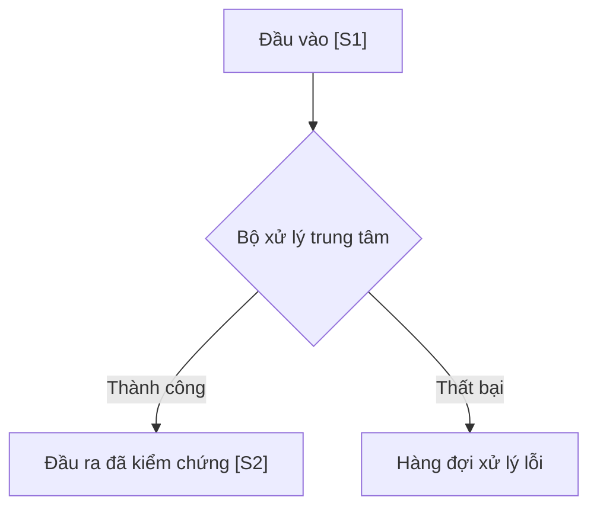

# BÀI HỌC TỔNG HỢP: [CHỦ ĐỀ HỌC TẬP]
*Module bài học đa nguồn [M02_slug] — Trích xuất từ [S1], [S2]*

## 1. Bức Tranh Tổng Thể & Kiến Trúc Luồng

## 2. Các Luận Điểm Cốt Lõi (Synthesized Principles)
- **Luận điểm 1:** Nguyên lý vận hành chính dựa trên cơ chế phân tách trách nhiệm `[S1]`.
- **Luận điểm 2:** Trong điều kiện tải cao, giải pháp ưu tiên là xếp hàng bất đồng bộ `[S2]`.

## 3. Bảng So Sánh Đối Đầu Trực Diện
| Tiêu chí | Hướng tiếp cận A [S1] | Hướng tiếp cận B [S2] |
|---|---|---|
| **Độ phức tạp** | Thấp, dễ triển khai | Trung bình, cần cơ chế đồng bộ |
| **Hiệu năng** | Phù hợp hệ thống nhỏ | Mở rộng quy mô tốt |
| **Cạm bẫy thường gặp** | Nghẽn cổ chai khi dữ liệu lớn | Khó gỡ lỗi khi có sự cố |

## 4. Câu Hỏi Đào Sâu (Active Retrieval Questions)
1. Trong trường hợp nào thì hướng tiếp cận A hoàn toàn thất bại?
2. Nếu kết hợp ưu điểm của cả hai nguồn, kiến trúc tối ưu nhất sẽ có hình thù như thế nào?

## 5. Tiêu Chí Đánh Giá (Embedded Rubric)
| Tiêu chí | Mức 0 (Chưa đạt) | Mức 1 (Đạt yêu cầu) | Mức 2 (Thành thạo) |
|---|---|---|---|
| **Độ chính xác nguồn** | Khẳng định không có nguồn gốc `[S#]` hoặc quy sai nguồn | Dẫn đúng nguồn nhưng chưa làm rõ sự khác biệt quan điểm | Tổng hợp mạch lạc, phân định ranh giới rõ ràng giữa các nguồn |
| **Mô hình tư duy** | Nhầm lẫn luồng dữ liệu hoặc bỏ sót mắt xích chính | Trình bày đúng luồng dữ liệu theo sơ đồ Mermaid | Tự vẽ lại hoặc phân tích được kịch bản lỗi biên của sơ đồ |
