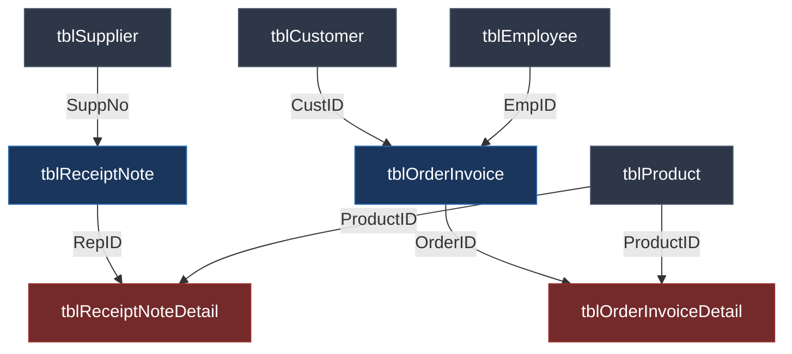

# BÀI HỌC CỐT LÕI: THIẾT KẾ LƯỢC ĐỒ QUAN HỆ & DDL CƠ BẢN (80/20 ERD TO SQL)

*Module M01_ddl-core-schema — Trọng tâm bài tập Tuần 5 & Chương 2 [S1]*

## 1. Trực Giác Cốt Lõi (Feynman Intuition)

- **Định nghĩa 1 câu kiểu Feynman:** Lệnh `CREATE TABLE` và khóa ngoại giống hệt như luật chơi xếp hình Lego: bạn không thể cắm viên gạch tầng 2 vào không khí — cái bàn hay cột chống (bảng cha) phải được đóng trước thì mới có chỗ cho cái ngăn kéo hay đinh ốc (khóa ngoại bảng con) bám vào.
- **Mục tiêu 80/20:** Viết trơn tru kịch bản SQL tạo toàn bộ 8 bảng của cơ sở dữ liệu `SaleManagement` (Quản lý bán hàng) chạy 1 phát phím `F5` mượt mà, không gặp lỗi `Foreign key references invalid table`.

## 2. Kiến Trúc Phụ Thuộc & Thứ Tự Tạo Bảng (Dependency Order)

### Nguyên tắc sống còn khi viết script DDL:

1. **Nhóm 1 — Bảng Độc Lập (Tạo trước tiên):** `tblSupplier`, `tblProduct`, `tblCustomer`, `tblEmployee`. Các bảng này chỉ chứa Khóa chính (`PRIMARY KEY`), không tham chiếu đến bất kỳ ai.
2. **Nhóm 2 — Bảng Giao Dịch Đơn Cấp (Tạo tiếp theo):** `tblReceiptNote` (tham chiếu `tblSupplier`), `tblOrderInvoice` (tham chiếu `tblCustomer` và `tblEmployee`).
3. **Nhóm 3 — Bảng Chi Tiết Cầu Nối (Tạo cuối cùng):** `tblReceiptNoteDetail` và `tblOrderInvoiceDetail`. Cả 2 bảng này đều có **Khóa chính phức hợp (Composite Primary Key)** gồm 2 cột kết hợp:
   - `PRIMARY KEY (RepID, ProductID)`
   - `PRIMARY KEY (OrderID, ProductID)`
4. **Vũ khí ngăn chặn lỗi bó lệnh:** Đặt từ khóa `GO` sau mỗi câu lệnh tạo database hoặc trước khi chuyển khối lệnh để SQL Server kết thúc batch xử lý.

## 3. Bẫy Trực Giác & So Sánh Đối Đầu

| Tình huống kỹ thuật                | Sai lầm phổ biến (0 điểm F5)                                                                                 | Chuẩn phòng thi (Điểm 10 F5)                                                 |
| -------------------------------------- | ----------------------------------------------------------------------------------------------------------------- | -------------------------------------------------------------------------------- |
| **Thứ tự script**              | Tạo bảng `tblOrderInvoiceDetail` đầu tiên trong file                                                       | Tạo bảng cha (`tblProduct`, `tblCustomer`...) trước, bảng con sau       |
| **Khóa chính bảng chi tiết** | Chỉ gán `PRIMARY KEY` cho riêng cột `OrderID` (làm mất khả năng lưu nhiều sản phẩm trên 1 đơn) | Khai báo ở cuối bảng: `PRIMARY KEY (OrderID, ProductID)`                   |
| **Cột sinh tự động**         | Dùng lệnh `ALTER TABLE` định thêm `IDENTITY` vào bảng đã tạo (SQL Server sẽ báo lỗi cú pháp!)  | Bắt buộc khai báo `IDENTITY(1,1)` ngay trong câu lệnh `CREATE TABLE`    |
| **Kiểu dữ liệu chuỗi**       | Dùng `VARCHAR` cho Tên người, Địa chỉ -> Rụng dấu tiếng Việt, hiển thị `???`                     | Dùng `NVARCHAR` và khi nhập dữ liệu chuỗi phải có tiền tố `N'...'` |

## 4. Chuỗi Câu Hỏi Socratic 3 Tầng

1. **Tier 1 (Bản chất cú pháp):** Tại sao trong bảng `tblOrderInvoiceDetail`, nếu ta chỉ đặt khóa chính đơn lên cột `OrderID`, thì một khách hàng khi mua 2 món hàng khác nhau (ví dụ: Áo thun và Quần jean) trên cùng 1 hóa đơn sẽ bị hệ thống chặn đứng ngay lập tức?
2. **Tier 2 (Biên phụ thuộc):** Giả sử bạn muốn xóa sạch cơ sở dữ liệu để chạy lại từ đầu bằng lệnh `DROP TABLE`. Nếu bạn gõ lệnh `DROP TABLE tblCustomer` trước khi xóa `tblOrderInvoice`, điều gì sẽ xảy ra? Thứ tự xóa bảng đúng phải ngược với thứ tự tạo bảng như thế nào?
3. **Tier 3 (Kiến trúc thực tế):** Trong giáo trình, cột số điện thoại `TelNo` được lưu dưới dạng `VARCHAR(11)` chứ không dùng kiểu số nguyên `INT` hay `BIGINT`. Hãy chỉ ra 2 lý do sư phạm/kỹ thuật tại sao số điện thoại và số CMND/CCCD bắt buộc phải lưu dạng chuỗi ký tự?

## 5. Tiêu Chí Đánh Giá (Embedded Rubric)

| Tiêu chí                                 | Mức 0 (Chưa nắm DDL)                                                      | Mức 1 (Đạt chuẩn chạy được)                                                                          | Mức 2 (Thành thạo tối ưu)                                                                                             |
| ------------------------------------------ | ---------------------------------------------------------------------------- | ------------------------------------------------------------------------------------------------------------ | -------------------------------------------------------------------------------------------------------------------------- |
| **Cấu trúc & Thứ tự tạo bảng** | Bị lỗi Foreign Key do sai thứ tự khai báo giữa các bảng              | Tạo đủ 8 bảng không lỗi, thứ tự bảng cha trước - bảng con sau                                    | Sử dụng `GO` hợp lý, script có thể chạy lặp lại an toàn (kiểm tra `IF NOT EXISTS` hoặc `DROP IF EXISTS`) |
| **Định nghĩa Khóa (Keys)**       | Khuyết khóa chính hoặc sai Composite Key ở bảng chi tiết              | Đặt đúng Simple PK và Composite PK cho 2 bảng chi tiết                                                | Khai báo khóa ngoại tường minh kèm đặt tên ràng buộc hoặc cú pháp inline ngắn gọn chuẩn xác              |
| **Kiểu dữ liệu & Quy chuẩn**     | Chọn sai kiểu (như dùng `INT` cho Phone, `VARCHAR` cho tiếng Việt) | Dùng đúng `NVARCHAR` cho chuỗi tiếng Việt, `MONEY` cho tiền tệ, `DATE/DATETIME` cho thời gian | Tối ưu độ rộng trường (`CHAR(6)`, `CHAR(7)`, `VARCHAR(11)`), có chú thích rõ ràng trước từng bảng    |
