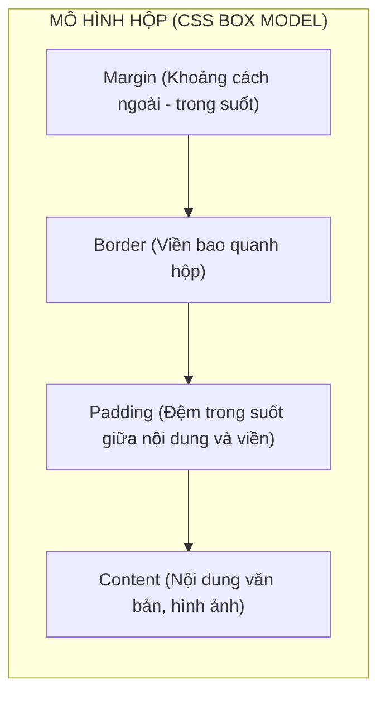
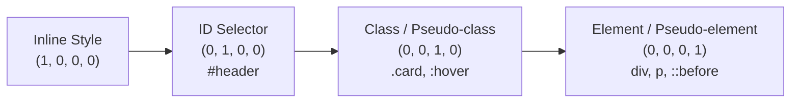

# BÀI HỌC TỔNG HỢP: CSS SELECTORS, SPECIFICITY & BOX MODEL
*Module M02_css-box-selectors — Trích xuất trọng tâm Chương 4 [S1]*

## 1. Trực Giác Cốt Lõi (Feynman Intuition)
- **Định nghĩa 1 câu kiểu Feynman:** Mọi phần tử trên trang web đều là một chiếc hộp các-tông (Box Model) chứa đồ đạc (Content), có lớp xốp bảo vệ chống va đập (Padding), bìa các-tông tạo khung (Border) và khoảng cách giữ an toàn với hộp hàng xóm (Margin).
- **Mục tiêu 80/20:** Làm chủ cơ chế tính toán kích thước thực tế bằng `box-sizing: border-box` và giải mã thuật toán phân xử quyền ưu tiên của CSS Specificity để không bao giờ phải dùng bừa `!important`.

## 2. Kiến Trúc Hộp & Thứ Bậc Ưu Tiên


### Nguyên lý Trọng số Ưu Tiên (CSS Specificity Score: (a, b, c, d))


## 3. Các Luận Điểm Cốt Lõi (Synthesized Principles)
- **Cứu cánh Layout `box-sizing: border-box`:**
  - Ở chế độ mặc định `content-box`: Chiều rộng thực tế của phần tử = `width` + `padding-left/right` + `border-left/right`. Thêm 20px padding khiến chiếc hộp phình to và làm vỡ toàn bộ hàng dàn trang!
  - Ở chế độ `border-box`: Chiều rộng khai báo là kích thước tối đa của toàn bộ hộp. Trình duyệt tự động co Content lại để nhường chỗ cho Padding và Border.
  - Quy tắc bất biến trong dự án thực tế: Khởi đầu file CSS luôn bằng bộ chọn toàn cục:
    ```css
    *, *::before, *::after {
      box-sizing: border-box;
    }
    ```
- **Quy tắc phân giải xung đột Specificity:**
  - Bảng tính điểm: `style="..."` thắng `#id`; `#id` thắng `.class`; `.class` thắng `tag`.
  - Nếu điểm bằng nhau, quy tắc nào được định nghĩa sau (viết ở dòng dưới) trong CSS sẽ đè quy tắc viết trước (Cascade rule).
  - Tránh tuyệt đối `!important`: `!important` phá vỡ mô hình phân tầng tự nhiên, biến mã nguồn thành "vũ khí hạt nhân" không thể ghi đè.

## 4. Bẫy Trực Giác & So Sánh Đối Đầu
| Tình huống | Chế độ `content-box` (Mặc định ngây thơ) | Chế độ `border-box` (Thực chiến chuẩn) |
|---|---|---|
| Khai báo `width: 100px; padding: 10px; border: 2px solid;` | Chiều rộng hiển thị = **124px** (Vỡ bố cục grid) | Chiều rộng hiển thị đúng bằng **100px** |
| Phản ứng khi sửa padding trong tương lai | Phải tính toán lại toàn bộ `width` của phần tử | `width` giữ nguyên, bố cục trang không xê dịch |
| Gộp lề trên dưới (Margin Collapse) | Hai thẻ `<p>` đứng cạnh nhau có `margin-bottom: 20px` và `margin-top: 15px` sẽ **gộp thành 20px**, không phải 35px! | Hiện tượng gộp lề vẫn diễn ra; xử lý bằng Padding hoặc Flexbox gap |

## 5. Chuỗi Câu Hỏi Socratic 3 Tầng
1. **Tier 1 (Dự đoán tiền đề):** Cho phần tử `<div id="main" class="box highlight" style="color: blue;">`. Trong CSS có quy tắc: `#main.box.highlight { color: red !important; }`. Văn bản sẽ hiển thị màu gì? Tại sao?
2. **Tier 2 (Biên & Đột biến):** Hai thẻ `<div>` nằm liên tiếp có `margin-bottom: 30px` và `margin-top: 20px`. Khoảng cách thực tế giữa chúng là bao nhiêu? Nếu ta đặt thuộc tính `display: flex` cho phần tử cha chứa chúng thì khoảng cách đó có thay đổi không?
3. **Tier 3 (Chuyển giao xa):** Tại sao các hệ thống Design System lớn (như Tailwind CSS, Bootstrap, Material UI) đều áp đặt `box-sizing: border-box` lên toàn bộ cây DOM (`*`) ngay tại dòng đầu tiên của file Reset CSS?

## 6. Tiêu Chí Đánh Giá (Embedded Rubric)
| Tiêu chí | Mức 0 (Chưa hiểu bản chất) | Mức 1 (Đạt yêu cầu) | Mức 2 (Thành thạo kiến trúc) |
|---|---|---|---|
| **Tính toán Box Model** | Quên cộng padding/border vào width khi tính kích thước phần tử | Tính đúng kích thước theo cả 2 chế độ `content-box` và `border-box` | Giải thích được nguyên nhân gây vỡ layout và hiện tượng gộp lề (Margin Collapse) |
| **Làm chủ Specificity** | Lạm dụng `!important` để giải quyết xung đột màu sắc/kích thước | Nhẩm chính xác trọng số 4 chữ số `(a, b, c, d)` của các bộ chọn | Thiết kế cấu trúc class phân cấp theo chuẩn BEM nhằm duy trì độ phức tạp phẳng |
| **Xử lý tình huống biên** | Không giải thích được vì sao padding trên thẻ `<span>` (inline) không đẩy dòng trên | Chỉ ra được sự khác biệt giữa `display: inline`, `inline-block`, và `block` | Tự tin debug thứ tự nạp stylesheet và các xung đột cascade phức tạp |
